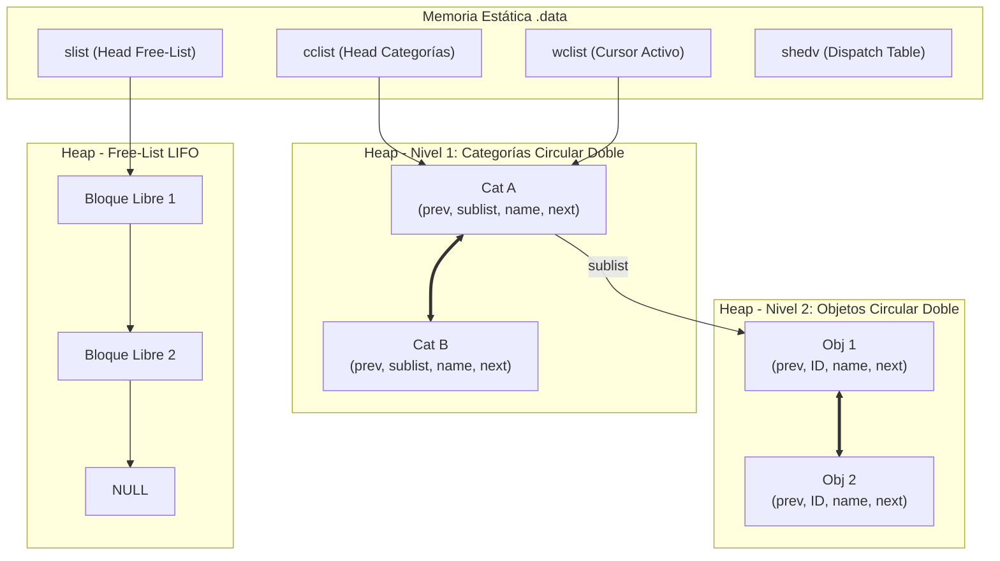
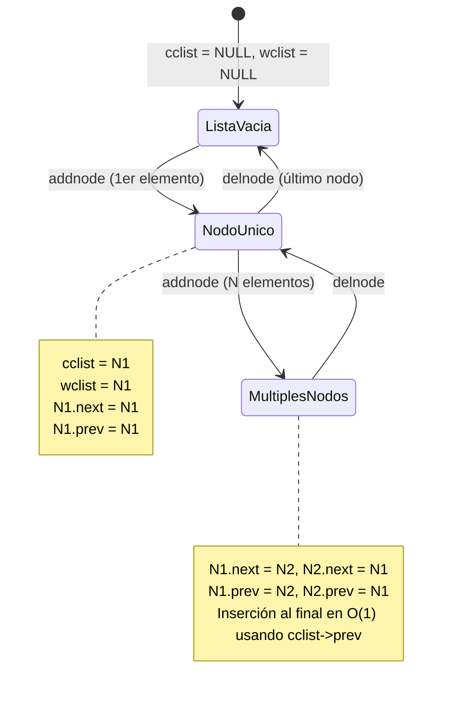

# Gestor Jerárquico de Colecciones en Memoria Dinámica (MIPS R2000 & C)

[](https://en.wikipedia.org/wiki/MIPS_architecture)
[](https://en.wikipedia.org/wiki/C_(programming_language))
[](http://courses.missouristate.edu/KenVollmar/mars/)
[]()

> **Trabajo Práctico Final — Examen Final**  
> **Cátedra:** Arquitectura de Computadoras I  
> **Autor:** Agustin Facchiano  
> **Archivo Principal de Entrega:** [`programaFinal.asm`](./programaFinal.asm)

---

## 📋 Tabla de Contenidos
1. [Descripción General](#-descripción-general)
2. [Fundamentos Arquitectónicos y Modelo de Memoria](#-fundamentos-arquitectónicos-y-modelo-de-memoria)
   - [Segmentación y Protección de Memoria](#segmentación-y-protección-de-memoria)
   - [Traducción MMU y Paginación](#traducción-mmu-y-paginación)
   - [Convergencia Heap-Stack y Límites](#convergencia-heap-stack-y-límites)
3. [Estructura de Datos: Anillos Jerárquicos Doblemente Enlazados](#-estructura-de-datos-anillos-jerárquicos-doblemente-enlazados)
   - [Layout Uniforme de Nodo (16 Bytes / 4 Words)](#layout-uniforme-de-nodo-16-bytes--4-words)
   - [Polimorfismo Estructural a Bajo Nivel](#polimorfismo-estructural-a-bajo-nivel)
   - [Topología de Punteros y Cursor Activo](#topología-de-punteros-y-cursor-activo)
4. [Subsistema de Gestión de Memoria (`smalloc` / `sfree`)](#-subsistema-de-gestión-de-memoria-smalloc--sfree)
   - [El Problema de `sbrk` sin `free` Nativo](#el-problema-de-sbrk-sin-free-nativo)
   - [Free-List LIFO Simplemente Enlazada](#free-list-lifo-simplemente-enlazada)
   - [Reciclaje de Bloques y Mitigación de Fragmentación](#reciclaje-de-bloques-y-mitigación-de-fragmentación)
5. [Patrones de Diseño e Implementación en Assembly](#-patrones-de-diseño-e-implementación-en-assembly)
   - [Tabla de Despacho de Funciones (*Function Dispatcher*)](#tabla-de-despacho-de-funciones-function-dispatcher)
   - [Convenciones de Llamada y Manejo del Stack Frame](#convenciones-de-llamada-y-manejo-del-stack-frame)
   - [Eliminación en Cascada (*Deep Deletion*)](#eliminación-en-cascada-deep-deletion)
6. [Catálogo de Primitivas y Subrutinas](#-catálogo-de-primitivas-y-subrutinas)
7. [Matriz de Códigos de Error](#-matriz-de-códigos-de-error)
8. [Prototipado en C vs. Implementación en MIPS](#-prototipado-en-c-vs-implementación-en-mips)
9. [Instrucciones de Ejecución](#-instrucciones-de-ejecución)
   - [Entorno MARS (MIPS Assembler and Runtime Simulator)](#entorno-mars)
   - [Compilación de los Prototipos en C](#compilación-de-los-prototipos-en-c)
10. [Estructura del Repositorio](#-estructura-del-repositorio)

---

## 🎯 Descripción General

Este proyecto implementa un motor interactivo de gestión de **colecciones categorizadas jerárquicas** de objetos en memoria dinámica, programado en ensamblador **MIPS R2000** de 32 bits a nivel de hardware/simulador, complementado con prototipos formales y pruebas de concepto desarrolladas en lenguaje **C**.

El núcleo del sistema resuelve problemáticas de ingeniería de software a muy bajo nivel:
- **Ausencia de recolector de basura o primitiva `free` nativa** en el conjunto de llamadas al sistema (syscalls) de MIPS.
- **Asignador de memoria dinámico personalizado (*custom memory allocator*)** de bloques fijos con lista de espacio libre (*free-list* LIFO), logrando tiempos de asignación y liberación en complejidad temporal $\mathcal{O}(1)$ sin fragmentación externa.
- **Estructura de datos anidada no lineal:** Lista circular doblemente enlazada de categorías (nivel maestro), donde cada nodo categoría hospeda a su vez un anillo circular doblemente enlazado de objetos secundarios (nivel esclavo).
- **Despachador de funciones por tabla de saltos (*Jump Table Dispatcher*)**, simulando polimorfismo dinámico e indexación de métodos vectorizados sin cadenas de bifurcaciones condicionales.



---

## 🧠 Fundamentos Arquitectónicos y Modelo de Memoria

### Segmentación y Protección de Memoria

El programa opera respetando la división lógica de los espacios de direccionamiento virtual de 32 bits en la arquitectura MIPS:

| Segmento | Directiva | Rango Virtual Típico | Permisos | Propósito |
| :--- | :--- | :--- | :--- | :--- |
| **Text Segment** | `.text` | `0x00400000` - `...` | Read / Execute | Instrucciones de máquina puras decodificadas por la CPU a través del Program Counter (`$pc`). Inmutable en tiempo de ejecución. |
| **Static Data** | `.data` | `0x10010000` - `...` | Read / Write | Variables globales (`slist`, `cclist`, `wclist`, `shedv`), literales de cadena ASCII y buffers no inicializados (`.space`). |
| **Dynamic Data (Heap)** | `syscall 9` | Crece hacia arriba ($\uparrow$) | Read / Write | Espacio reservado dinámicamente mediante desplazamiento del program break (`sbrk`). Aloja nodos y cadenas. |
| **Stack Segment** | `$sp` | Crece hacia abajo ($\downarrow$) | Read / Write | Marcos de pila (*stack frames*), direcciones de retorno (`$ra`) y preservación de registros salvados (`$s0-$s7`). |
| **Kernel Segment** | — | `0x80000000` - `0xFFFFFFFF` | Privilegiado | Reservado para el manejador de interrupciones, vectores de excepciones y despacho de *syscalls* del sistema operativo. |

```
Direcciones Altas (0x7FFFFFFF)
┌────────────────────────────────────────┐
│             STACK SEGMENT              │  Crece hacia abajo (↓) vía $sp
│       (Frames, $ra, $s0-$s7)           │
├────────────────────────────────────────┤
│                   ↓                    │
│             Espacio Libre              │  (Zona de convergencia / Guard pages)
│                   ↑                    │
├────────────────────────────────────────┤
│              HEAP SEGMENT              │  Crece hacia arriba (↑) vía sbrk
│      (Nodos 16B, Cadenas dinámicas)    │
├────────────────────────────────────────┤
│           STATIC DATA SEGMENT          │  Dirección Base 0x10010000
│  (cclist, wclist, slist, shedv, menu)  │
├────────────────────────────────────────┤
│              TEXT SEGMENT              │  Dirección Base 0x00400000 (R-X)
│       (Instrucciones de máquina)       │
└────────────────────────────────────────┘
Direcciones Bajas (0x00000000)
```

### Traducción MMU y Paginación

1. **Virtual Address Decomposition:** Toda dirección emitida por las instrucciones (`lw`, `sw`, `jalr`) es una dirección virtual que se segmenta en **Número de Página Virtual (VPN)** y **Desplazamiento (*Offset*)**.
2. **Tablas de Páginas y TLB:** La Unidad de Manejo de Memoria (**MMU**) consulta el Translation Lookaside Buffer (TLB) o las tablas de páginas del proceso para mapear dicho VPN al Marco de Página Física (**PFN**) en la memoria RAM real.
3. **Fallas de Segmentación (*Segmentation Fault*):** Ocurren cuando el software transgrede las fronteras asignadas:
   - **Stack Overflow:** Agotamiento del marco por llamadas anidadas o recursión no balanceada sin restaurar `$sp`.
   - **Heap Corruption / Out-of-bounds:** Lecturas/escrituras en bloques no concedidos por el break pointer.
   - **Colisión Heap-Stack:** Cuando la memoria física virtualizada se agota y los dos segmentos contrapuestos impactan contra las *guard pages*.

### Convergencia Heap-Stack y Límites

La convención arquitectónica de crecimiento divergente (Heap hacia arriba $\uparrow$, Stack hacia abajo $\downarrow$) responde a una necesidad de diseño: en tiempo de compilación es imposible predecir con exactitud el nivel de anidamiento de llamadas ni la cantidad de llamadas dinámicas a memoria que requerirá el usuario. Crecer en sentidos opuestos maximiza la flexibilidad sobre la memoria libre compartida.

---

## 🧬 Estructura de Datos: Anillos Jerárquicos Doblemente Enlazados

### Layout Uniforme de Nodo (16 Bytes / 4 Words)

Para evitar la fragmentación externa y permitir la reutilización de primitivas de bajo nivel, **todos los nodos del sistema comparten exactamente un tamaño fijo de 16 bytes** (4 palabras alineadas a 32 bits):

```
       +0x00                +0x04                +0x08                +0x0C
┌────────────────────┬────────────────────┬────────────────────┬────────────────────┐
│   Word 0 (Offset 0)│   Word 1 (Offset 4)│   Word 2 (Offset 8)│  Word 3 (Offset 12)│
├────────────────────┼────────────────────┼────────────────────┼────────────────────┤
│    prev pointer    │  objects / ID data │    char* name      │    next pointer    │
└────────────────────┴────────────────────┴────────────────────┴────────────────────┘
```

### Polimorfismo Estructural a Bajo Nivel

En ensamblador no existen comprobaciones de tipo en tiempo de compilación. Las directivas de memoria operan sobre bytes crudos. El programa explota este principio implementando **polimorfismo estructural**:

| Campo | Offset | Semántica en `CategoryNode` | Semántica en `ObjectNode` | Semántica en `FreeNode` (slist) |
| :--- | :--- | :--- | :--- | :--- |
| **Word 0** | `0($reg)` | `struct CategoryNode* prev` | `struct ObjectNode* prev` | No utilizado (basura lógica) |
| **Word 1** | `4($reg)` | `struct ObjectNode* sublist` | `int32_t id` (Identificador) | No utilizado |
| **Word 2** | `8($reg)` | `char* categoryName` | `char* objectName` | No utilizado |
| **Word 3** | `12($reg)` | `struct CategoryNode* next` | `struct ObjectNode* next` | `struct FreeNode* next` |

Gracias a que tanto `prev` como `next` residen en los offsets `0` y `12` en ambas entidades, las primitivas de enlace y desenlace (`addnode`, `delnode`) operan agnósticamente de si están manipulando una categoría o un objeto.

### Topología de Punteros y Cursor Activo

1. **Estado Vacío:** La lista vacía se representa cuando el puntero raíz (`cclist` o `node->objects`) contiene `0` (`NULL`).
2. **Nodo Aislado / Único:** Un elemento solitario en el anillo circular satisface la propiedad:
   $$\text{node} \to \text{next} == \text{node} \quad \land \quad \text{node} \to \text{prev} == \text{node}$$
3. **Puntero Cursor (`wclist`):** Actúa como el cursor de trabajo activo (*working category*). Todas las operaciones de creación de objetos, listado de objetos y navegación se ejecutan de manera relativa a `wclist`. La lista no pierde su anclaje principal (`cclist`), permitiendo navegación circular bidireccional continua $\mathcal{O}(1)$.



---

## ♻️ Subsistema de Gestión de Memoria (`smalloc` / `sfree`)

### El Problema de `sbrk` sin `free` Nativo

En entornos reales y simuladores de MIPS (como MARS o SPIM), el servicio de sistema `syscall 9` (`sbrk`) incrementa la frontera del montículo (*heap break*). No existe un `syscall` análogo a la función `free()` estándar de C para devolver memoria al sistema operativo. 

Si un programa solicita memoria continuamente al crear y destruir nodos, el heap crecería indefinidamente, provocando un agotamiento de memoria virtual o colisión prematura contra el stack.

### Free-List LIFO Simplemente Enlazada

Para solventar esta limitación arquitectónica, se diseñó un **administrador de memoria personalizado** (*free-list manager*):

- **Variable Global `slist` (`.word 0`):** Puntero a la cabeza de una lista enlazada simple de bloques reciclados.
- **Inserción en `sfree` ($\mathcal{O}(1)$):** Cuando un nodo de 16 bytes se libera, no se sobreescribe ni se destruye; se inserta al inicio de `slist` reutilizando el offset `12` (Word 3) del propio nodo como puntero al siguiente bloque libre:
  ```mips
  sfree:
      lw    $t0, slist
      sw    $t0, 12($a0)        # node->next = slist
      sw    $a0, slist          # slist = node
      jr    $ra
  ```
- **Asignación en `smalloc` ($\mathcal{O}(1)$):** Antes de invocar al sistema operativo, consulta `slist`:
  - Si `slist != NULL`: Extrae el nodo del tope de la lista libre (*pop*), actualiza `slist = slist->next` y retorna la dirección reciclada.
  - Si `slist == NULL`: Invoca formalmente `syscall 9` (`sbrk`) solicitando 16 bytes limpios.

### Reciclaje de Bloques y Mitigación de Fragmentación

Al estandarizar tanto las estructuras `CategoryNode`, `ObjectNode` como los buffers de texto de `getblock` en múltiplos de **16 bytes**, el asignador **anula por completo la fragmentación externa**. Cualquier bloque liberado puede suplir indistintamente la solicitud de un nodo de categoría, un nodo de objeto o un búfer de cadena.

---

## ⚙️ Patrones de Diseño e Implementación en Assembly

### Tabla de Despacho de Funciones (*Function Dispatcher*)

Para desacoplar el bucle principal de control (`main_loop`) de una densa cadena de instrucciones condicionales (`beq`/`bne`), se implementó un vector de salto indexado (`shedv`):

```mips
.data
shedv:    .space 32    # 8 entradas de 4 bytes (punteros a subrutina)
```

Durante el arranque (`main`), se inicializan las direcciones base de los controladores:
- `shedv[0] = &newcategory`
- `shedv[1] = &nextcategory`
- `shedv[2] = &prevcategory`
- `shedv[3] = &listcategories`
- `shedv[4] = &delcategory`
- `shedv[5] = &newobject`
- `shedv[6] = &listobjects`
- `shedv[7] = &delobject`

#### Cálculo de Dirección Aritmética en Tiempo de Ejecución:
Dado un entero $K \in [1, 8]$ validado por `validation`:
$$\text{Offset} = (K - 1) \ll 2 \quad (\text{equivalente a } (K-1) \times 4)$$
$$\text{Target Address} = *(\text{shedv} + \text{Offset})$$

```mips
move    $t1, $v0            # $t1 = opción ingresada (1..8)
addi    $t1, $t1, -1        # Indexación 0..7
sll     $t1, $t1, 2         # Offset en bytes (multiplicación por 4)
add     $t2, $s0, $t1       # $s0 = base de shedv
lw      $t2, 0($t2)         # Carga puntero a la rutina
jalr    $t2                 # Despacho indirecto
```

### Convenciones de Llamada y Manejo del Stack Frame

El código sigue estrictamente las directrices del **MIPS ABI**:
- **Registros Argumento (`$a0-$a3`):** Utilizados para paso de parámetros.
- **Registros de Retorno (`$v0-$v1`):** Retornan punteros o códigos de estado.
- **Registros Temporales (`$t0-$t9`):** Volátiles entre llamadas.
- **Registros Salvados (`$s0-$s7`):** Preservados a través del stack frame si la función los modifica.
- **Registro de Retorno (`$ra`):** En funciones no-hoja (*non-leaf subroutines*, como `newcategory`, `addnode`, `delcategory`), `$ra` se apila en el prólogo y se restaura en el epílogo para permitir subllamadas anidadas sin corromper el retorno al invocador.

```mips
# Ejemplo de prólogo y epílogo estándar en delcategory:
addi    $sp, $sp, -12       # Reserva frame de 12 bytes
sw      $ra, 8($sp)         # Preserva return address
sw      $s0, 4($sp)         # Preserva $s0 (puntero a categoría)
sw      $s1, 0($sp)         # Preserva $s1 (iterador de objetos)

# ... cuerpo de la subrutina ...

lw      $s1, 0($sp)         # Restaura registros salvados
lw      $s0, 4($sp)
lw      $ra, 8($sp)
addi    $sp, $sp, 12        # Balancea el puntero de pila
jr      $ra                 # Retorno
```

### Eliminación en Cascada (*Deep Deletion*)

Cuando el usuario solicita eliminar una categoría mediante `delcategory`:
1. Comprueba si la categoría posee objetos subordinados inspeccionando su offset `4` (`node->objects`).
2. Si la lista de objetos no está vacía, se ejecuta un bucle iterativo que desenlaza cada nodo objeto llamando a `delnode` y enviándolo a `sfree`.
3. Una vez vaciada la lista esclava, se procede a aislar el nodo categoría del anillo maestro `cclist`.
4. Si la categoría a eliminar era la apuntada por el cursor `wclist`, el cursor avanza preventivamente a `node->next`. Si era el único nodo remanente, `cclist` y `wclist` se reestablecen a `NULL`.

---

## 🛠 Catálogo de Primitivas y Subrutinas

| Subrutina | Tipo | Argumentos | Retorno | Descripción Técnica |
| :--- | :--- | :--- | :--- | :--- |
| `smalloc` | Primitiva | Ninguno | `$v0`: Dirección de memoria | Retira un bloque de `slist` si existe; de lo contrario invoca `syscall 9` (16 bytes). |
| `sfree` | Primitiva | `$a0`: Dirección del bloque | Ninguno | Inserta el bloque al frente de `slist` actualizando el puntero global. |
| `addnode` | Primitiva | `$a0`: `&list_head`<br>`$a1`: `ID` o `NULL`<br>`$a2`: `char* name` | `$v0`: Puntero al nuevo nodo | Solicita 16 bytes a `smalloc`, inicializa campos y enlaza en tiempo $\mathcal{O}(1)$ al final del anillo circular aprovechando `head->prev`. |
| `delnode` | Primitiva | `$a0`: Puntero al nodo<br>`$a1`: `&list_head` | Ninguno | Desenlaza el nodo del anillo, ajusta referencias de los vecinos contiguos, reubica el head si era el primer nodo, y transfiere el nodo a `sfree`. |
| `getblock` | Utilidad | `$a0`: Cadena prompt | `$v0`: Dirección del buffer | Asigna 16 bytes en heap mediante `smalloc` y lee por consola vía `syscall 8`. |
| `validation`| Utilidad | `$a0`: Opción ingresada | `$v0`: Opción o `101` | Comprueba que la opción numérica esté estrictamente en el intervalo $[0, 8]$. |
| `newcategory` | Menú #1 | Ninguno | `$v0`: `0` (Éxito) | Solicita nombre de categoría, invoca `addnode` sobre `cclist` y asigna `wclist` inicial si correspondía. |
| `nextcategory`| Menú #2 | Ninguno | `$v0`: `0`, `201`, `202` | Avanza `wclist = wclist->next` informando el nuevo nodo seleccionado. |
| `prevcategory`| Menú #3 | Ninguno | `$v0`: `0`, `201`, `202` | Retrocede `wclist = wclist->prev` informando el nuevo nodo seleccionado. |
| `listcategories`| Menú #4 | Ninguno | `$v0`: `-1`, `301` | Recorre el anillo de categorías imprimiendo sus nombres e identificando con `> ` la categoría activa. |
| `delcategory` | Menú #5 | Ninguno | `$v0`: `0`, `401` | Realiza la eliminación en cascada de los objetos hijos y recicla la categoría actual. |
| `newobject` | Menú #6 | Ninguno | `$v0`: `0`, `501` | Genera un ID autoincremental ($ID_{nuevo} = ID_{último} + 1$), pide nombre e inserta en la sublista del nodo actual. |
| `listobjects` | Menú #7 | Ninguno | `$v0`: `-1`, `601`, `602` | Itera la lista circular de objetos de la categoría activa imprimiendo Nombre e ID. |
| `delobject` | Menú #8 | Ninguno | `$v0`: `0`, `-1`, `701` | Solicita un ID por teclado, realiza una búsqueda lineal en el anillo de objetos y desenlaza el elemento coincidente. |

---

## ⚠️ Matriz de Códigos de Error

El programa posee un esquema formalizado de códigos de error por subsistema:

| Código | Subrutina Origen | Causa Semántica | Comportamiento del Sistema |
| :---: | :--- | :--- | :--- |
| **`101`** | `validation` / `main` | Selección de menú fuera del rango $[0, 8]$. | Muestra `.Error: 101` y reinicia el menú interactivo. |
| **`201`** | `nextcategory` / `prevcategory` | Se intentó navegar en una lista de categorías vacía (`cclist == NULL`). | Notifica error por pantalla; no altera punteros. |
| **`202`** | `nextcategory` / `prevcategory` | Existe una única categoría (`node->next == node`). | La navegación no produce desplazamiento efectivo. |
| **`301`** | `listcategories` | Se invocó el listado pero no existen categorías registradas. | Notifica lista vacía. |
| **`401`** | `delcategory` | Se intentó borrar una categoría sobre una lista vacía. | Operación abortada. |
| **`501`** | `newobject` | Se intentó agregar un objeto sin que exista ninguna categoría contenedora. | Impide la creación de objetos huérfanos. |
| **`601`** | `listobjects` | No existen categorías registradas en el sistema. | Operación abortada. |
| **`602`** | `listobjects` | La categoría actual existe pero no contiene ningún objeto en su lista interna. | Notifica lista de objetos vacía. |
| **`701`** | `delobject` | No existen categorías registradas. | Operación abortada. |
| **`-1`** | Rutinas varias | Código de control interno para suprimir la impresión del mensaje de éxito. | Flujo normal sin banner redundante. |

---

## 🔬 Prototipado en C vs. Implementación en MIPS

El desarrollo del proyecto adoptó una metodología estructurada de ingeniería inversa y diseño descendente (*Top-Down*):

```
┌────────────────────────────────┐
│   1. Abstracción y Modelo      │  Definición matemática de anillos y flujos de datos.
└───────────────┬────────────────┘
                ▼
┌────────────────────────────────┐
│   2. Prototipo en ANSI C       │  Validación algorítmica de punteros dobles y recursión
│  (enC/listaEnlazadaDoble...)   │  usando malloc() y free() del runtime de C.
└───────────────┬────────────────┘
                ▼
┌────────────────────────────────┐
│   3. Desglose Arquitectónico   │  Eliminación de abstracciones: tipos, variables locales
│     (listaSimple.asm)          │  y heap administrado por SO.
└───────────────┬────────────────┘
                ▼
┌────────────────────────────────┐
│   4. Implementación MIPS Final │  Mapeo manual a registros, stack frames, alineación
│       (programaFinal.asm)      │  de palabras y dispatch table dinámico.
└────────────────────────────────┘
```

### Equivalencias Clave entre Paradigmas:

1. **Gestión de Heap:**
   - En **C**: `malloc(sizeof(Node))` calcula automáticamente el tamaño y delega en `glibc` la búsqueda en el heap. `free(ptr)` realiza *coalescing* (fusión de bloques adyacentes).
   - En **MIPS**: `smalloc` calcula un offset de 16 bytes fijos, llamando a `syscall 9` o reciclando el nodo directamente en tiempo $\mathcal{O}(1)$ desde `slist`.
2. **Acceso a Miembros de Estructuras:**
   - En **C**: `nodo->nextCategory` (el compilador resuelve el offset basado en los tipos de los campos precedentes).
   - En **MIPS**: `lw $reg, 12($base)` (el programador calcula y asegura manualmente la alineación a palabra).
3. **Despacho de Subrutinas:**
   - En **C**: Bloque `switch(opcion) { case 1: ... }`.
   - En **MIPS**: Aritmética de punteros sobre el vector estático `shedv` e instrucción `jalr`.

---

## 🚀 Instrucciones de Ejecución

### Entorno MARS

El programa está optimizado para ejecutarse en **MARS (MIPS Assembler and Runtime Simulator)** v4.5+:

1. Descargar y abrir MARS:
   ```bash
   java -jar Mars4_5.jar
   ```
2. Abrir el archivo fuente:  
   `File` $\to$ `Open...` $\to$ Seleccionar [`programaFinal.asm`](./programaFinal.asm).
3. Ensamblar el código:  
   Presionar `F3` o `Run` $\to$ `Assemble`.
4. Configuración de Memoria recomendada:
   - Asegurarse de que en `Settings` $\to$ `Memory Configuration` esté seleccionada la opción por defecto: **Compact, Data at address 0x10000000** o **Standard Default**.
5. Ejecutar la simulación:  
   Presionar `F5` o `Run` $\to$ `Go`. La interacción se realiza mediante la consola integrada de MARS (*Run I/O*).

### Compilación de los Prototipos en C

Para compilar y verificar el comportamiento del prototipo de referencia en lenguaje C:

```bash
# Compilar prototipo principal de lista doble circular jerárquica
gcc -Wall -Wextra -std=c99 enC/listaEnlazadaDobleCircular.c -o build/listaDobleCircular

# Compilar prueba de concepto de lista enlazada simple
gcc -Wall -Wextra -std=c99 enC/lista_simple.c -o build/listaSimple

# Ejecución
./build/listaDobleCircular
```

---

## 📂 Estructura del Repositorio

```text
.
├── programaFinal.asm              # ENTREGA FINAL: Código fuente completo en ensamblador MIPS R2000
├── listaSimple.asm                # PoC: Implementación elemental de lista enlazada simple en MIPS
├── docs/                          # Suite de documentación técnica especializada
│   ├── 01-fundamentos-teoricos-y-memoria.md # Marco teórico: MMU, paginación, límites y tipos en Assembly
│   ├── 02-gestion-de-memoria-y-punteros.md  # Custom Allocator, free vs sfree y punteros globales
│   ├── 03-especificacion-de-subrutinas.md  # Detalle exhaustivo de las 12 subrutinas y ABI
│   └── 04-flujo-operativo-y-casos-de-uso.md # Máquina de estados, FSM, ciclo de vida y casos borde
├── ejemplosEnC/                   # Prototipos de validación en lenguaje C
│   ├── listaEnlazadaDobleCircular.c # Implementación completa de referencia en C
│   └── lista_simple.c             # Algoritmos base de lista simple y manipulación de nodos
└── README.md                      # Documentación técnica formal del proyecto
```

### 📚 Documentación Técnica Detallada

Para una profundización exhaustiva en cada componente del sistema, consultar los módulos dedicados:

- 📖 **[01. Fundamentos Teóricos y Modelo de Memoria](./docs/01-fundamentos-teoricos-y-memoria.md):** Tratamiento profundo de la MMU, segmentación vs paginación, colisión Heap-Stack, límites naturales vs artificiales, y la desmitificación de tipos y punteros en bajo nivel (`void*`).
- ♻️ **[02. Gestión de Memoria y Punteros](./docs/02-gestion-de-memoria-y-punteros.md):** Análisis del asignador de 16 bytes fijos, comparación rigurosa con `free()` de C (coalescing y fragmentación), y la anatomía de `slist`, `cclist`, `wclist` y `shedv`.
- ⚙️ **[03. Especificación de Subrutinas](./docs/03-especificacion-de-subrutinas.md):** Manual técnico paso a paso de las 12 subrutinas implementadas, stack frames, convenciones de llamada y la filosofía de alcanzabilidad en el borrado.
- 🔄 **[04. Flujo Operativo y Casos de Uso](./docs/04-flujo-operativo-y-casos-de-uso.md):** Análisis de la Máquina de Estados Finitos (FSM), ciclo de navegación con el cursor, eliminación en cascada (*Leaf* vs *Non-Leaf*) y matriz integral de transiciones.

---

## 👨‍💻 Autor

- **Agustin Facchiano**  
  *Tecnicatura Universitaria en Administración y Sistemas / Licenciatura en Ciencias de la Computación*  
  Materia: **Arquitectura de Computadoras I**
