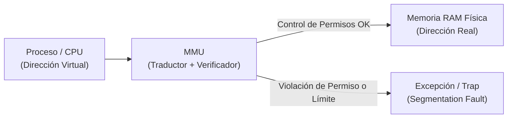

# Fundamentos Teóricos: Arquitectura, Memoria y Abstracciones de Bajo Nivel

> **Materia:** Arquitectura de Computadoras I  
> **Tema:** Segmentación, MMU, Paginación, Modelo de Memoria MIPS y Desmitificación de Abstracciones  
> **Documento Complementario:** Marco conceptual del proyecto [`programaFinal.asm`](../programaFinal.asm)

---

## 📋 Índice Temático
1. [El Concepto de Segmento de Memoria](#1-el-concepto-de-segmento-de-memoria)
2. [Protección de Memoria y Unidad de Gestión de Memoria (MMU)](#2-protección-de-memoria-y-unidad-de-gestión-de-memoria-mmu)
3. [Paginación y Tablas de Páginas](#3-paginación-y-tablas-de-páginas)
4. [Anatomía del Segmentation Fault](#4-anatomía-del-segmentation-fault)
5. [Convergencia Heap-Stack: Justificación Arquitectónica](#5-convergencia-heap-stack-justificación-arquitectónica)
6. [Límites de Memoria: Naturales vs. Artificiales](#6-límites-de-memoria-naturales-vs-artificiales)
7. [Desmitificación de las Abstracciones de Alto Nivel](#7-desmitificación-de-las-abstracciones-de-alto-nivel)
   - [¿Qué es realmente un tipo de dato?](#qué-es-realmente-un-tipo-de-dato)
   - [Directivas de almacenamiento en ensamblador MIPS](#directivas-de-almacenamiento-en-ensamblador-mips)
   - [La ilusión del puntero y la semántica de `void*`](#la-ilusión-del-puntero-y-la-semántica-de-void)
   - [Separación de memoria y significado](#separación-de-memoria-y-significado)

---

## 1. El Concepto de Segmento de Memoria

En arquitectura de computadoras, un **segmento de memoria** no es una división física del silicio de la memoria RAM, sino una **región lógica del espacio de direccionamiento virtual** asignado a un proceso. Cada segmento responde a un diseño arquitectónico premeditado que persigue tres objetivos fundamentales:
1. **Facilitar el diseño del hardware y la CPU:** El procesador y el decodificador de instrucciones esperan hallar código ejecutable en ciertas direcciones y datos manipulables en otras.
2. **Simplificar el trabajo del compilador y ensamblador:** Permite predecir y organizar las secciones estáticas sin interferir con los datos que crecerán dinámicamente en tiempo de ejecución.
3. **Imponer políticas de seguridad y permisos diferenciados:** Aislar el código del usuario de los datos, y al proceso de usuario del Sistema Operativo (SO).

Un segmento define un contrato de tres componentes:
- **Propósito bien definido:** Código de máquina, constantes y variables globales, variables locales efímeras o datos dinámicos.
- **Conjunto de reglas operativas:** Crecimiento hacia direcciones crecientes o decrecientes, alineación a palabra (32 bits / 4 bytes).
- **Atributos de protección (Permisos):** Lectura ($R$), Escritura ($W$) y Ejecución ($X$).

### Distribución de los Segmentos Principales

```
+-------------------------------------------------------------+
| Direcciones Altas (0x7FFFFFFF)                              |
|                                                             |
|   ┌─────────────────────────────────────────────────────┐   |
|   │ STACK SEGMENT ($sp)                                 │   |  Permisos: RW-
|   │ Marcos de pila, variables locales, direcciones $ra  │   |  Crece hacia abajo (↓)
|   └──────────────────────────┬──────────────────────────┘   |
|                              │                              |
|                              ▼                              |
|                    (Espacio Virtual Libre)                  |
|                              ▲                              |
|                              │                              |
|   ┌──────────────────────────┴──────────────────────────┐   |
|   │ HEAP SEGMENT (brk / sbrk)                           │   |  Permisos: RW-
|   │ Nodos dinámicos, buffers de texto, free-lists       │   |  Crece hacia arriba (↑)
|   ├─────────────────────────────────────────────────────┤   |
|   │ STATIC DATA SEGMENT (.data / .bss)                  │   |  Base: 0x10010000
|   │ Punteros globales (slist, cclist), menús, strings   │   |  Permisos: RW- (Inmutable en tamaño)
|   ├─────────────────────────────────────────────────────┤   |
|   │ TEXT SEGMENT (.text)                                │   |  Base: 0x00400000
|   │ Instrucciones de máquina decodificadas por $pc      │   |  Permisos: R-X (Solo lectura y ejecución)
|   └─────────────────────────────────────────────────────┘   |
|                                                             |
| Direcciones Bajas (0x00000000)                              |
+-------------------------------------------------------------+
| KERNEL SEGMENT (0x80000000 - 0xFFFFFFFF)                    |
| Código del SO, manejador de interrupciones, syscalls        |  Permisos: Privilegiado (Nivel 0)
+-------------------------------------------------------------+
```

1. **Text Segment (`.text`):** Aloja las instrucciones en lenguaje de máquina. El Program Counter (`$pc`) se inicializa apuntando a este rango. Es estrictamente **solo lectura y ejecutable ($R-X$)**. Cualquier intento de sobrescribir una dirección del `.text` mediante un `sw` gatilla una excepción inmediata del procesador, impidiendo que código malicioso modifique el flujo del programa o que errores del software destruyan su propio código.
2. **Static Data Segment (`.data`):** Contiene los datos estáticos cuya vida útil abarca toda la ejecución del proceso (equivalente a variables globales en C). Su tamaño se conoce con exactitud en tiempo de ensamblado y permanece constante.
3. **Dynamic Data Segment (Heap):** Espacio reservado para memoria dinámica solicitada en tiempo de ejecución mediante la llamada al sistema `sbrk` (`syscall 9`).
4. **Stack Segment:** Gestionado por el registro puntero de pila (`$sp`), almacena los marcos de activación (*stack frames*), direcciones de retorno (`$ra`) y registros preservados (`$s0-$s7`).
5. **Kernel Segment:** Región de memoria protegida donde reside el sistema operativo, los vectores de excepción y las rutinas de atención de *syscalls*. Inaccesible en modo usuario.

---

## 2. Protección de Memoria y Unidad de Gestión de Memoria (MMU)

La **Protección de Memoria** (*Memory Protection*) es una estrategia conjunta de hardware (procesador, MMU) y software (sistema operativo) para garantizar la integridad del sistema. Impide que un proceso:
- Acceda a regiones de memoria que pertenecen al sistema operativo.
- Modifique la memoria asignada a otros procesos concurrentes.
- Escriba sobre segmentos marcados como de solo lectura (como `.text`).
- Ejecute datos en segmentos no ejecutables (protección contra inyecciones de código tipo *Buffer Overflow* o exploits *shellcode*).

### La Unidad de Gestión de Memoria (MMU)

La CPU nunca emite direcciones físicas directamente a la memoria RAM. Todas las instrucciones de la CPU (`lw`, `sw`, `jalr`, búsqueda de instrucciones por `$pc`) operan sobre **direcciones virtuales**.



#### Flujo de Traducción:
$$\text{Dirección Virtual} \xrightarrow{\text{MMU + Tablas de Páginas / TLB}} \text{Dirección Física en RAM}$$

### Aislamiento de Espacios de Direcciones Virtuales
Una pregunta recurrente en arquitectura es: **¿Por qué dos procesos distintos pueden utilizar exactamente la misma dirección virtual (por ejemplo, `0x10010000`) sin interferir entre sí?**

La respuesta reside en la virtualización:
- Cada proceso posee su propio espacio de memoria virtual de 32 bits ($4\text{ GB}$ teóricos).
- La dirección virtual `0x10010000` del **Proceso A** está mapeada por la MMU al marco físico `0x00A12000` de la RAM física.
- La dirección virtual `0x10010000` del **Proceso B** está mapeada por la MMU al marco físico `0x08F4C000` de otra región completamente distinta de la RAM física.
- Al conmutar de tarea (*context switch*), el sistema operativo actualiza el registro base de la MMU (el registro que apunta a la tabla de páginas del proceso activo). De esta forma, el mismo número virtual apunta a un casillero físico de silicio totalmente diferente.

---

## 3. Paginación y Tablas de Páginas

El hardware y el sistema operativo no gestionan la memoria virtual byte a byte, ya que el costo de metadatos sería colosal. En su lugar, el espacio de direcciones se particiona en bloques de tamaño fijo denominados **Páginas Virtuales** (*Pages*), típicamente de $4\text{ KB}$ ($4096\text{ bytes} = 2^{12}\text{ bytes}$). La memoria física correspondiente se particiona en bloques idénticos denominados **Marcos de Página Física** (*Page Frames*).

### Descomposición de una Dirección Virtual (32 bits)

Con páginas de $4\text{ KB}$ ($2^{12}$ bytes):
- Los 12 bits menos significativos ($[11:0]$) representan el **Desplazamiento (*Offset*)** dentro de la página. El offset no se traduce: es idéntico en la dirección virtual y en la física.
- Los 20 bits más significativos ($[31:12]$) corresponden al **Número de Página Virtual (VPN - Virtual Page Number)**.

$$\begin{array}{|c|c|}
\hline
\text{VPN (Virtual Page Number)} \quad [31:12] \text{ (20 bits)} & \text{Offset} \quad [11:0] \text{ (12 bits)} \\
\hline
\end{array}$$

### La Tabla de Páginas (*Page Table*)
La **Tabla de Páginas** es una estructura de datos mantenida por el kernel del sistema operativo para cada proceso:
1. La MMU toma el **VPN** de la dirección virtual emitida.
2. Indexa la tabla de páginas activa (o consulta el caché de traducciones de alta velocidad, el **TLB - Translation Lookaside Buffer**).
3. Obtiene una entrada (*PTE - Page Table Entry*) que contiene:
   - El **PFN (Page Frame Number)**: Dirección base del marco en la RAM física.
   - **Bits de control y permisos:** Bit de presencia ($V=1$ si está en RAM, $0$ si está en swap/disco), bit de lectura ($R$), bit de escritura ($W$), bit de ejecución ($X$), bit de modo usuario/kernel ($U/K$).
4. Si la operación viola los permisos (por ejemplo, escribir con `sw` en una página con $W=0$), la MMU genera una excepción de hardware.
5. Si la página no reside en RAM ($V=0$), se produce un **Fallo de Página (*Page Fault*)**: el SO toma el control, suspende el proceso, lee el bloque desde el almacenamiento secundario (disco/swap), lo carga en un marco libre de RAM, actualiza la tabla de páginas y reanuda la instrucción interrumpida.

---

## 4. Anatomía del Segmentation Fault

Un **Fallo de Segmentación (*Segmentation Fault*)** ocurre cuando un proceso intenta acceder a una dirección virtual que no forma parte de su espacio de direcciones concedido o realiza una operación incompatible con los permisos de la página. No significa que la memoria física se haya roto; significa que se **violó el contrato de segmentación impuesto por la MMU y el sistema operativo**.

### Casos de Falla Típicos en Sistemas de Bajo Nivel

1. **Stack Overflow (Desbordamiento de Pila):**
   - Ocurre cuando sucesivas llamadas a funciones (por ejemplo, recursión sin caso base o con frames excesivamente grandes) decrementan `$sp` más allá del espacio permitido para la pila, invadiendo zonas no mapeadas o colisionando con el Heap.
2. **Heap Corruption y Accesos Fuera de Límite (*Out-of-bounds*):**
   - Sucede cuando un puntero lee o escribe más allá de la frontera del *program break* otorgado por `sbrk`. En el proyecto, si se intentara escribir a una distancia arbitraria sin haber llamado previamente a `smalloc`, la MMU detectará que la página no está asignada.
3. **Colisión Heap-Stack:**
   - Si tanto el Heap (creciendo hacia arriba) como el Stack (creciendo hacia abajo) consumen todo el espacio virtual intermedio, ambas estructuras entrarían en colisión. Para evitar la corrupción silenciosa de datos, los sistemas operativos ubican **Páginas de Guarda (*Guard Pages*)** sin permisos de lectura ni escritura entre ambos segmentos. Al tocar esta página, el hardware detiene inmediatamente el proceso.
4. **Desbalanceo del Puntero de Pila (`$sp`):**
   - En ensamblador MIPS, si una subrutina reserva espacio (`addi $sp, $sp, -12`) pero omite restaurarlo antes de retornar (`jr $ra`), el registro `$sp` quedará desplazado. En ejecuciones sucesivas, la pila se agotará rápidamente o `$ra` contendrá basura, provocando un salto a una dirección inexistente.

---

## 5. Convergencia Heap-Stack: Justificación Arquitectónica

Una de las decisiones más elegantes en el diseño de arquitecturas de computadoras es la convención de **crecimiento en sentidos opuestos**:
- El **Heap crece hacia arriba** ($\uparrow$, hacia direcciones de memoria más altas).
- El **Stack crece hacia abajo** ($\downarrow$, hacia direcciones de memoria más bajas).

### ¿Por qué existe esta convención?

En el momento de compilar o ensamblar un programa, el tamaño del código (`.text`) y de las variables globales (`.data`) es **estático y perfectamente predecible**:
$$\text{Tamaño Total Estático} = \text{Tamaño}(\text{.text}) + \text{Tamaño}(\text{.data})$$

Sin embargo, los requisitos de memoria del **Stack** y del **Heap** son **propiedades puramente dinámicas del tiempo de ejecución**:
- **El Stack depende de la profundidad de llamadas:** Una función que calcula el factorial de forma recursiva ocupa un espacio de pila radicalmente distinto si el argumento es $4$ respecto a si el argumento es $200$. El compilador no puede predecir cuántos niveles de llamada anidada decidirá ejecutar el usuario.
- **El Heap depende de la demanda de datos:** No es posible saber en compilación cuántas llamadas a `smalloc` o `malloc` se harán, de qué tamaño serán, ni cuánto tiempo vivirán antes de ser recicladas.

### Ventajas del Crecimiento Convergente

```
[ Heap (crece ↑) ] ====> [ Espacio Libre Compartido ] <==== [ Stack (crece ↓) ]
```

1. **Aprovechamiento elástico del espacio libre:** Si un programa hace un uso intensivo del Heap pero utiliza muy pocas llamadas a funciones (poco Stack), el Heap puede expandirse sobre casi la totalidad del espacio libre disponible. A la inversa, si un programa tiene una recursión profunda pero casi no solicita memoria dinámica, el Stack puede aprovechar ese mismo espacio.
2. **Prevención del desperdicio:** Si ambos segmentos crecieran en el mismo sentido, se requeriría imponer un límite rígido intermedio a cada uno. Si el Stack superara su cupo asignado, fallaría aunque al lado hubiese gigabytes de memoria sin utilizar por el Heap. El crecimiento en direcciones opuestas maximiza la flexibilidad sin desperdicio.

---

## 6. Límites de Memoria: Naturales vs. Artificiales

Un **límite de memoria** es una dirección virtual máxima o mínima más allá de la cual un proceso no tiene permiso para operar.

| Tipo de Límite | Definición | Causa / Origen | Ejemplo en Sistemas |
| :--- | :--- | :--- | :--- |
| **Límite Natural** | Aquel que surge inevitablemente de la **realidad física y arquitectónica** del sistema. No es impuesto arbitrariamente por una regla de software, sino por el agotamiento real de los recursos. | Tamaño del bus de direcciones físico, agotamiento de la memoria RAM real instalada, o la colisión física entre el puntero de pila `$sp` y el break pointer del Heap. | Cuando no queda un solo marco de página física libre en el sistema y el espacio de swap en disco se ha saturado por completo. |
| **Límite Artificial** | Aquel impuesto por **diseño de software, políticas del SO o decisiones del programador**, aun cuando el hardware físico dispone de recursos suficientes. | Cuotas de usuario impuestas por el sistema operativo (`ulimit -s` en Linux), o el tamaño fijo de un buffer estático. | Declarar en C `char buffer[1024];`: si el usuario ingresa 1025 caracteres, el programa falla o rechaza el dato, aunque la computadora disponga de 32 GB de RAM ociosa. |

En el diseño de [`programaFinal.asm`](../programaFinal.asm), el límite de los buffers de cadena a 16 bytes mediante `getblock` constituye un **límite artificial de diseño**, adoptado con el fin de unificar el tamaño de todos los bloques en el Heap y erradicar por completo la fragmentación externa.

---

## 7. Desmitificación de las Abstracciones de Alto Nivel

Los lenguajes de alto nivel como C, C++, Java o Rust ofrecen sistemas de tipos estrictos (`int`, `float`, `struct`, punteros fuertemente tipados). En ensamblador y a nivel de silicio, **estas abstracciones desaparecen por completo**.

### ¿Qué es realmente un tipo de dato?

Para el procesador MIPS R2000, **los tipos de datos no existen**. La CPU solo conoce secuencias de bits organizadas en:
- Bytes (8 bits).
- Medias palabras (16 bits / Halfwords).
- Palabras completas (32 bits / Words).

Un tipo de dato en un lenguaje de alto nivel es únicamente:
1. Un **contrato en tiempo de compilación** que especifica cuántos bytes reservar.
2. Una **restricción semántica** que le indica al compilador qué instrucciones de máquina son válidas sobre ese bloque y cuáles deben prohibirse.

Una vez que el compilador traduce el código a ensamblador, **el tipo se destruye**: solo quedan desplazamientos numéricos y registros.

### Directivas de Almacenamiento en Ensamblador MIPS

| Directiva MIPS | Bytes Reales Reservados | Interpretación de Silicio | Significado en Alto Nivel |
| :--- | :---: | :--- | :--- |
| `.word 5` | 4 bytes (32 bits) | Almacena los bits `0x00000005`. | Puede ser un entero con signo, sin signo, una máscara de bits, un puntero a función o una dirección de memoria. La CPU no distingue la diferencia. |
| `.space 32` | 32 bytes continuos | Reserva 32 bytes en memoria sin inicializar (`.bss`). | Equivale a declarar un arreglo crudo en memoria (como `shedv`, el vector de saltos del menú). |
| `.ascii "Hola"` | 4 bytes contiguos | Almacena los códigos ASCII: `0x48`, `0x6F`, `0x6C`, `0x61`. | Caracteres literales sin terminador nulo. |
| `.asciiz "Hola"` | 5 bytes contiguos | Almacena los 4 códigos ASCII anteriores seguidos del byte nulo `0x00` (`'\0'`). | Cadena estándar compatible con llamadas al sistema (`syscall 4`). |

#### ¿Qué es realmente una etiqueta (*Label*)?
En código como:
```mips
slist:    .word 0
```
La palabra `slist` **no es una variable**: es una **etiqueta simbólica**. Durante la fase de ensamblado, el ensamblador reemplaza cada aparición de `slist` por su dirección numérica absoluta en memoria (por ejemplo, `0x10010000`). Una etiqueta no es más que un alias legible para un número de 32 bits.

### La Ilusión del Puntero y la Semántica de `void*`

En C, un puntero es una variable que almacena la dirección de otra variable. Existen punteros a enteros (`int*`), punteros a estructuras (`struct Node*`), etc. El compilador de C prohíbe, por ejemplo, sumar un entero a un `void*` sin un casteo explícito, porque desconoce el tamaño del elemento al que apunta.

En ensamblador MIPS:
- **Todo puntero es ontológicamente un `void*`**.
- Un puntero es simplemente un valor entero de 32 bits que reside en un registro o en una palabra de memoria.
- La **interpretación** la da exclusivamente la instrucción que el programador elija para operarlo:
  - Si se utiliza `lw $t0, 0($a0)`, el procesador interpreta que `$a0` contiene una dirección alineada a 4 bytes y lee una palabra entera.
  - Si se utiliza `lb $t0, 0($a0)`, el procesador lee un único byte.
  - Si se utiliza `jalr $t0`, el procesador interpreta que `$t0` contiene la dirección de una instrucción ejecutable en el `.text`.

### Separación de Memoria y Significado

Este principio arquitectónico se explota al máximo en el diseño del nodo uniforme de 16 bytes de [`programaFinal.asm`](../programaFinal.asm):

```
       Offset 0            Offset 4            Offset 8            Offset 12
 ┌───────────────────┬───────────────────┬───────────────────┬───────────────────┐
 │   Word 0 (4B)     │   Word 1 (4B)     │   Word 2 (4B)     │   Word 3 (4B)     │
 └───────────────────┴───────────────────┴───────────────────┴───────────────────┘
```

El procesador asigna y manipula 16 bytes de memoria contigua en el Heap. **La memoria es agnóstica a lo que representa**. Es el programador quien define el significado en función del contexto:
- En una **Categoría**, el `Offset 4` se interpreta como una dirección virtual que apunta al anillo de objetos subordinados (`CategoryNode->objects`).
- En un **Objeto**, ese mismo `Offset 4` se interpreta como un número entero escalar que representa el identificador único (`ObjectNode->id`).
- En la lista de reciclaje (`slist`), los offsets `0`, `4` y `8` se ignoran por completo, y el `Offset 12` se reutiliza como el puntero de enlace simple al siguiente bloque libre.

Esta separación absoluta entre **la memoria física asignada** y **el significado lógico atribuido** es la esencia del polimorfismo estructural a bajo nivel en la arquitectura MIPS.
