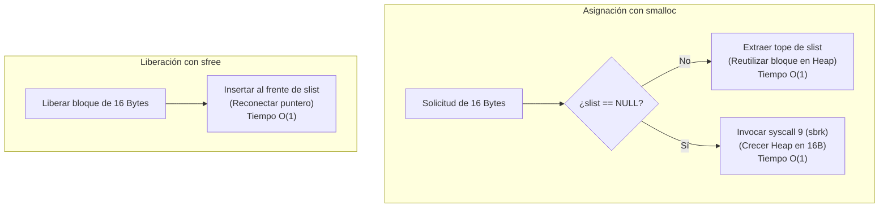
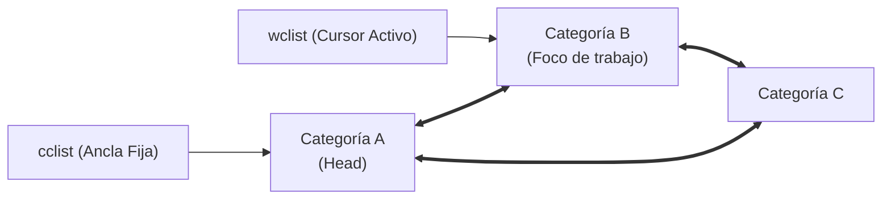

# Gestión de Memoria Dinámica, Custom Allocator y Topología de Punteros

> **Materia:** Arquitectura de Computadoras I  
> **Tema:** Asignador de Memoria Fija, Free-List LIFO, Eliminación de Fragmentación y Punteros Globales  
> **Documento Complementario:** Análisis interno del sistema de memoria en [`programaFinal.asm`](../programaFinal.asm)

---

## 📋 Índice Temático
1. [El Problema de la Memoria Dinámica en MIPS](#1-el-problema-de-la-memoria-dinámica-en-mips)
2. [El Asignador de Memoria Personalizado (Custom Allocator)](#2-el-asignador-de-memoria-personalizado-custom-allocator)
   - [Diseño del Bloque Uniforme de 16 Bytes](#diseño-del-bloque-uniforme-de-16-bytes)
   - [Mecanismo LIFO de la Free-List (`slist`)](#mecanismo-lifo-de-la-free-list-slist)
   - [Análisis Algorítmico y Complejidad $\mathcal{O}(1)$](#análisis-algorítmico-y-complejidad-mathcalo1)
3. [Comparativa: `sfree` vs. `free()` Estándar de C (glibc)](#3-comparativa-sfree-vs-free-estándar-de-c-glibc)
   - [Metadatos y Headers en Bloques de Memoria](#metadatos-y-headers-en-bloques-de-memoria)
   - [El Problema de la Fragmentación Externa](#el-problema-de-la-fragmentación-externa)
   - [Coalescing (Fusión de Bloques Vecinos)](#coalescing-fusión-de-bloques-vecinos)
4. [Anatomía de los Punteros Globales en `.data`](#4-anatomía-de-los-punteros-globales-en-data)
   - [`slist`: La Cabeza de la Lista de Bloques Libres](#slist-la-cabeza-de-la-lista-de-bloques-libres)
   - [`cclist`: El Ancla Estática de Categorías](#cclist-el-ancla-estática-de-categorías)
   - [`wclist`: El Cursor Activo y el Patrón Scheduler](#wclist-el-cursor-activo-y-el-patrón-scheduler)
   - [`shedv`: Vector de Despacho Indirecto (Jump Table)](#shedv-vector-de-despacho-indirecto-jump-table)
5. [Topología Jerárquica: El Ejemplo de la Taxonomía Animal](#5-topología-jerárquica-el-ejemplo-de-la-taxonomía-animal)

---

## 1. El Problema de la Memoria Dinámica en MIPS

En la arquitectura MIPS y en sus entornos de simulación (como MARS o SPIM), la interacción con la memoria dinámica provista por el sistema operativo es extremadamente primitiva. El sistema operativo expone únicamente el servicio `syscall 9` (`sbrk`):

```mips
li    $v0, 9        # Código de syscall para sbrk
li    $a0, 16       # Cantidad de bytes a solicitar
syscall             # Retorna en $v0 la dirección base del nuevo bloque en el Heap
```

Cada invocación a `sbrk` incrementa la frontera del montículo (*program break*), desplazándola hacia direcciones de memoria más altas. **No existe una llamada al sistema complementaria para liberar memoria (`free`)**.

### La Consecuencia del Crecimiento Sin Reciclaje
Si una aplicación crea y destruye objetos continuamente utilizando solo `sbrk`:
1. El Heap crece de manera monótona y descontrolada.
2. Cada nodo liberado queda abandonado como basura en el Heap.
3. Se produce un **agotamiento prematuro del espacio de direcciones virtual** o una colisión catastrófica del Heap contra el Stack Segment (*colisión Heap-Stack*), provocando un *Segmentation Fault*.

Para resolver este desafío a bajo nivel, fue indispensable implementar un **subsistema propio de administración de memoria**.

---

## 2. El Asignador de Memoria Personalizado (Custom Allocator)

El sistema implementa un asignador de memoria basado en **bloques fijos homogéneos** asistido por una **Free-List LIFO (Last-In, First-Out)**.



### Diseño del Bloque Uniforme de 16 Bytes

En lugar de manejar tamaños arbitrarios (lo cual exigiría complicados algoritmos de asignación como *Best-Fit* o *Buddy Allocation*), el sistema estandariza **absolutamente todos los bloques dinámicos en 16 bytes** (4 palabras alineadas de 32 bits):
- Los nodos de categoría (`CategoryNode`) ocupan exactamente 16 bytes.
- Los nodos de objeto (`ObjectNode`) ocupan exactamente 16 bytes.
- Los búferes de texto para nombres creados por `getblock` se reservan exactamente en 16 bytes.

```
+0x00               +0x04               +0x08               +0x0C
┌───────────────────┬───────────────────┬───────────────────┬───────────────────┐
│ Word 0 (4 Bytes)  │ Word 1 (4 Bytes)  │ Word 2 (4 Bytes)  │ Word 3 (4 Bytes)  │
├───────────────────┼───────────────────┼───────────────────┼───────────────────┤
│    prev node      │  objects / ID     │   char* name      │    next node      │
└───────────────────┴───────────────────┴───────────────────┴───────────────────┘
```

### Mecanismo LIFO de la Free-List (`slist`)

La variable global `slist` en `.data` (`.word 0`) almacena la dirección de memoria del bloque disponible más recientemente liberado. 

Cuando un bloque de 16 bytes se encuentra en desuso:
- **No se borran sus datos:** La memoria física no se sobrescribe con ceros ni se limpia el silicio.
- **Se reconecta a la lista libre:** Se reutiliza el **Offset 12 (Word 3)** del propio bloque como puntero al siguiente bloque libre de la cadena.
- **Inserción LIFO:** El bloque se inserta al inicio de `slist`.

```mips
sfree:
    lw    $t0, slist          # $t0 = bloque libre actual al tope
    sw    $t0, 12($a0)        # bloque->next = slist
    sw    $a0, slist          # slist = bloque
    jr    $ra
```

Cuando una subrutina requiere memoria (`smalloc`):
```mips
smalloc:
    lw    $t0, slist          # Consulta la cabeza de libres
    beqz  $t0, sbrk           # Si es NULL, solicita sbrk al SO
    move  $v0, $t0            # Retorna el bloque libre
    lw    $t0, 12($t0)        # Extrae el bloque: slist = bloque->next
    sw    $t0, slist
    jr    $ra
sbrk:
    li    $a0, 16             # 16 bytes limpios
    li    $v0, 9
    syscall
    jr    $ra
```

### Análisis Algorítmico y Complejidad $\mathcal{O}(1)$

Tanto la asignación (`smalloc`) como la liberación (`sfree`) son operaciones de **tiempo constante estricto $\mathcal{O}(1)$**:
- **Sin bucles de búsqueda:** No es necesario recorrer ninguna lista en busca de un bloque del tamaño adecuado. Cualquier bloque de la free-list tiene garantizado el tamaño de 16 bytes.
- **Operaciones de punteros elementales:** Ambas rutinas ejecutan un número fijo e invariable de instrucciones de máquina (4 a 6 instrucciones MIPS).

---

## 3. Comparativa: `sfree` vs. `free()` Estándar de C (glibc)

Para apreciar la elegancia y especificidad del asignador desarrollado, es instructivo contrastarlo con la implementación de `malloc()` y `free()` en la biblioteca estándar de C (`glibc` ptmalloc):

| Característica | `free()` Estándar en C (glibc) | `sfree` en este Proyecto (MIPS) |
| :--- | :--- | :--- |
| **Tamaño de Bloque** | Variable (desde 16 bytes hasta gigabytes). | **Fijo e invariable (16 bytes).** |
| **Metadatos en Nodo Activo** | **Sobrecarga de cabecera (*Chunk Header*):** Cada bloque en uso gasta 8 o 16 bytes adicionales contiguos para registrar el tamaño del bloque y banderas de estado (*PREV_INUSE*). | **Cero sobrecarga de metadatos:** Todo el bloque de 16 bytes está disponible para datos del usuario. |
| **Almacenamiento del Puntero Libre** | Cuando el bloque está libre, sobrescribe los primeros bytes del espacio de datos con punteros (`fd`, `bk`). | Sobrescribe únicamente el Offset 12 (Word 3) del bloque libre con el puntero al siguiente bloque libre. |
| **Fragmentación Externa** | **Problema crítico:** La intercalación de asignaciones y liberaciones de tamaños dispares deja "huecos" inutilizables en el Heap. | **Completamente inexistente ($0\%$):** Cualquier bloque liberado encaja a la perfección con cualquier solicitud futura. |
| **Coalescing (Fusión de Bloques)** | **Obligatorio:** Al liberar un bloque, `free()` debe inspeccionar los vecinos físicos anterior y posterior para unificarlos si están libres, evitando la fragmentación. | **Innecesario:** Al ser bloques fijos, nunca se requiere fusionar bloques adyacentes. |
| **Complejidad Temporal** | Amortizada $\mathcal{O}(1)$ en *fastbins*, pero puede degradar a $\mathcal{O}(N)$ en *unsorted bins* con coalescing. | **Estrictamente $\mathcal{O}(1)$ en el peor de los casos.** |

### El Problema de la Fragmentación Externa

La **fragmentación externa** ocurre cuando existe suficiente memoria libre total en el Heap para satisfacer una solicitud, pero dicha memoria está dividida en pequeños bloques no contiguos:

```
Heap Fragmentado en C:
[ Usado: 32B ] [ Libre: 16B ] [ Usado: 64B ] [ Libre: 16B ]
* Si el programa pide 32B, la solicitud falla o agranda el Heap,
  aun cuando hay 32B libres totales (16B + 16B separados).
```

En nuestro sistema, este problema queda matemáticamente anulado:
$$\forall b \in \text{Heap}, \quad \text{Size}(b) = 16\text{ Bytes} \implies \text{Fragmentación Externa} \equiv 0$$

Cualquier bloque devuelto por la eliminación de un objeto puede convertirse de inmediato en una categoría, y un bloque devuelto por una categoría eliminada puede reutilizarse para un nombre de texto de `getblock`.

---

## 4. Anatomía de los Punteros Globales en `.data`

El programa coordina toda su estructura mediante cuatro punteros maestros ubicados en el segmento de datos estáticos:

```mips
.data
slist:    .word 0       # 0x10010000 -> Cabeza de la Free-List LIFO
cclist:   .word 0       # 0x10010004 -> Cabeza de la lista circular de categorías
wclist:   .word 0       # 0x10010008 -> Cursor de trabajo activo
shedv:    .space 32     # 0x1001000C -> Vector de 8 punteros a subrutinas (Jump Table)
```

### `slist`: La Cabeza de la Lista de Bloques Libres
- **Rol:** Administrador del reciclaje de memoria.
- **Valor Inicial:** `0` (`NULL`).
- **Comportamiento:** Si `slist == 0`, no hay bloques disponibles para reciclar; `smalloc` recurre a `sbrk`. Tan pronto como una entidad se destruye con `delnode`, `slist` apunta al bloque devuelto.

### `cclist`: El Ancla Estática de Categorías
- **Rol:** Raíz y punto de anclaje de la estructura de datos jerárquica.
- **Valor Inicial:** `0` (`NULL`).
- **Comportamiento:** Permanece apuntando siempre al **primer nodo categoría creado**. Nunca se desplaza durante la navegación del usuario. Solo se modifica cuando:
  - Se añade la primera categoría (`cclist` pasa de `0` a `&Cat1`).
  - Se elimina la categoría que coincidía con la cabeza (`cclist` avanza a `node->next`).
  - Se vacía la totalidad del sistema (`cclist` vuelve a ser `0`).

### `wclist`: El Cursor Activo y el Patrón Scheduler
- **Rol:** Puntero a la **categoría de trabajo activa** (*working category*).
- **Inspiración Arquitectónica:** Emula el cursor de proceso activo (*current running task*) utilizado en los planificadores circulares (*Round-Robin Schedulers*) de los sistemas operativos.
- **Propósito:** Al tratarse de una lista circular sin principio ni fin absoluto, el sistema necesita conocer en todo momento **sobre qué categoría recaen las operaciones del usuario**:
  - Insertar un nuevo objeto (`newobject` añade el nodo en `wclist->objects`).
  - Listar los objetos actuales (`listobjects` recorre `wclist->objects`).
  - Borrar la categoría actual (`delcategory` remueve el nodo apuntado por `wclist`).
  - Navegación bidireccional: `nextcategory` hace `wclist = wclist->next`, y `prevcategory` hace `wclist = wclist->prev`.



### `shedv`: Vector de Despacho Indirecto (Jump Table)
- **Rol:** Simulador de polimorfismo dinámico y reemplazo de bifurcaciones condicionales.
- **Estructura:** Reserva 32 bytes continuos en `.data` (8 ranuras de 4 bytes para direcciones de 32 bits).
- **Mecanismo:** En el arranque (`main`), se cargan las etiquetas de las 8 subrutinas del menú interactivo:
  $$\text{shedv}[i] = \&\text{Rutina}_{i+1}, \quad i \in [0, 7]$$
- **Despacho Indirecto con `jalr`:**
  Dado un número de opción $K \in [1, 8]$ validado por `validation`:
  $$\text{Offset en Bytes} = (K - 1) \times 4 = (K - 1) \ll 2$$
  $$\text{Dirección de Rutina} = *(\text{shedv} + \text{Offset})$$

```mips
move    $t1, $v0            # $v0 contiene la opción (1..8)
addi    $t1, $t1, -1        # Índice base 0 (0..7)
sll     $t1, $t1, 2         # Multiplicación por 4 (offset en bytes)
add     $t2, $s0, $t1       # $s0 es la base de shedv
lw      $t2, 0($t2)         # Carga la dirección de la subrutina
jalr    $t2                 # Salta y enlaza a la rutina de destino
```

Este patrón elimina la necesidad de escribir una cadena de 8 instrucciones `beq`/`bne`, reduciendo drásticamente los saltos condicionales (*branch prediction penalties* en procesadores segmentados).

---

## 5. Topología Jerárquica: El Ejemplo de la Taxonomía Animal

Para visualizar con claridad el flujo de datos y la organización en el Heap, consideremos un caso de modelado práctico: una **Taxonomía del Reino Animal**.

```mermaid
graph TD
    subgraph Anillo Maestro de Categorías (cclist)
        C1["Mamíferos\n(prev, sublist, name, next)"] <===> C2["Reptiles\n(prev, sublist, name, next)"]
        C2 <===> C3["Aves\n(prev, sublist, name, next)"]
        C3 <===> C1
    end

    subgraph Sub-anillo de Objetos: Mamíferos
        M1["León (ID: 1)"] <===> M2["Elefante (ID: 2)"]
        M2 <===> M1
    end

    subgraph Sub-anillo de Objetos: Reptiles
        R1["Cocodrilo (ID: 1)"] <===> R2["Iguana (ID: 2)"]
        R2 <===> R3["Serpiente (ID: 3)"]
        R3 <===> R1
    end

    C1 -.->|sublist (Offset 4)| M1
    C2 -.->|sublist (Offset 4)| R1
    C3 -.->|sublist (Offset 4)| NULO["NULL (Sin objetos)"]
```

### Propiedades Clave de esta Topología:
1. **Autonomía de los Sub-anillos:** Cada categoría mantiene su propia lista circular cerrada de objetos en su Offset 4. Los objetos de la categoría "Reptiles" son completamente invisibles e inaccesibles desde la categoría "Mamíferos".
2. **Propiedad del Nodo Único:** Si en "Mamíferos" existiera únicamente el objeto "León", sus punteros `next` y `prev` apuntarían a sí mismo. El valor `NULL` (`0`) aparece **únicamente cuando no hay objetos** (como en la categoría "Aves").
3. **Inserción al Final en $\mathcal{O}(1)$:** Cuando se añade un tercer mamífero ("Ballena"), no es necesario recorrer la lista desde el inicio. Al ser una lista circular, **el último elemento de la lista siempre se encuentra inmediatamente en `head->prev`**:
   $$\text{Último Nodo} = *(\text{head} + 0)$$
   Esto permite insertar al final del anillo actualizando únicamente 4 punteros en tiempo constante.
