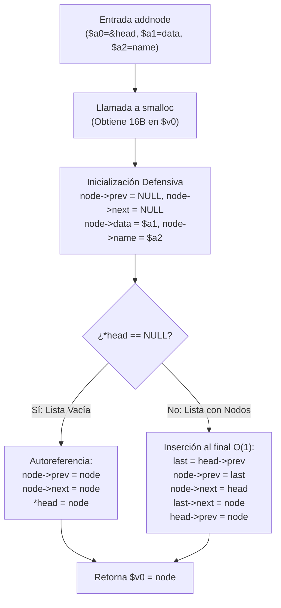
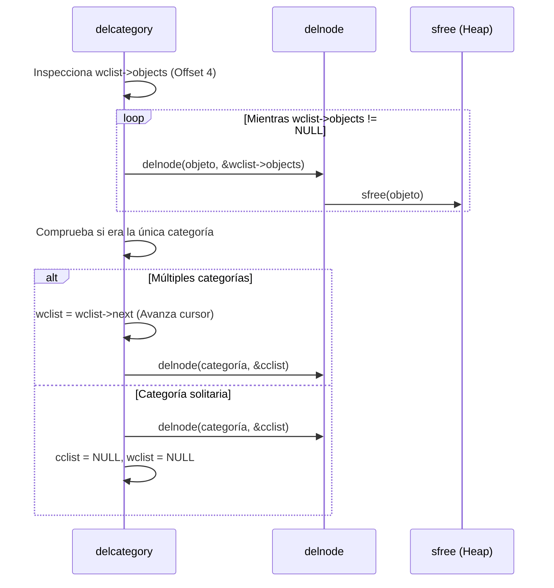

# Especificación Técnica de Subrutinas y Primitivas

> **Materia:** Arquitectura de Computadoras I  
> **Tema:** Desglose Algorítmico, Stack Frames, Convenciones MIPS ABI y Gestión de Nodos  
> **Documento Complementario:** Referencia exhaustiva de funciones implementadas en [`programaFinal.asm`](../programaFinal.asm)

---

## 📋 Índice de Subrutinas
1. [Primitivas de Memoria y Nodos](#1-primitivas-de-memoria-y-nodos)
   - [`smalloc`: Asignación de Bloque de 16 Bytes](#smalloc)
   - [`sfree`: Liberación y Reciclaje LIFO de Bloque](#sfree)
   - [`addnode`: Inserción en Anillo Circular Doblemente Enlazado](#addnode)
   - [`delnode`: Desenlace y Reciclado de Nodo](#delnode)
   - [`getblock`: Asignación y Lectura de Búfer de Cadena](#getblock)
2. [Subrutina de Utilidad](#2-subrutina-de-utilidad)
   - [`validation`: Validación de Rango de Opciones](#validation)
3. [Subrutinas de Nivel 1: Categorías](#3-subrutinas-de-nivel-1-categorías)
   - [`newcategory`: Creación de Nueva Categoría](#newcategory)
   - [`nextcategory`: Avance del Cursor Activo](#nextcategory)
   - [`prevcategory`: Retroceso del Cursor Activo](#prevcategory)
   - [`listcategories`: Recorrido y Muestra de Categorías](#listcategories)
   - [`delcategory`: Eliminación en Cascada (Deep Deletion)](#delcategory)
4. [Subrutinas de Nivel 2: Objetos Subordinados](#4-subrutinas-de-nivel-2-objetos-subordinados)
   - [`newobject`: Creación de Objeto con ID Autoincremental](#newobject)
   - [`listobjects`: Listado de Objetos de la Categoría Activa](#listobjects)
   - [`delobject`: Búsqueda Lineal y Borrado de Objeto por ID](#delobject)
5. [Análisis Conceptual: La Filosofía del Borrado a Bajo Nivel](#5-análisis-conceptual-la-filosofía-del-borrado-a-bajo-nivel)

---

## 1. Primitivas de Memoria y Nodos

### `smalloc`
- **Propósito:** Proveer un bloque de 16 bytes alineado a 32 bits, priorizando la reutilización de bloques libres antes de solicitar memoria al sistema operativo.
- **Tipo de Función:** Hoja (*Leaf Subroutine*). No requiere stack frame.
- **Entradas:** Ninguna.
- **Salidas:** `$v0`: Dirección base del bloque concedido en el Heap.
- **Registros Utilizados:** `$t0`, `$a0`, `$v0`.

#### Flujo Operativo:
1. Lee el valor del puntero global `slist`.
2. Si `slist != 0`:
   - Copia la dirección en `$v0` (el bloque actual al tope).
   - Lee el puntero al siguiente bloque libre ubicado en el Offset 12 del bloque: `lw $t0, 12($t0)`.
   - Actualiza la cabeza de la lista libre: `slist = $t0`.
   - Retorna de inmediato en tiempo $\mathcal{O}(1)$.
3. Si `slist == 0`:
   - Configura `$a0 = 16` y `$v0 = 9` (`sbrk`).
   - Ejecuta `syscall`. MARS desplaza el *break pointer* del Heap y retorna en `$v0` la nueva dirección.

---

### `sfree`
- **Propósito:** Recibir un bloque de 16 bytes en desuso y reinsertarlo en la lista libre `slist` mediante una inserción LIFO al frente.
- **Tipo de Función:** Hoja (*Leaf Subroutine*). No requiere stack frame.
- **Entradas:** `$a0`: Dirección del bloque a liberar.
- **Salidas:** Ninguna.
- **Registros Utilizados:** `$t0`, `$a0`.

#### Flujo Operativo:
1. Carga la dirección actual de `slist` en `$t0`.
2. Almacena `$t0` en el Offset 12 del nodo entrante: `sw $t0, 12($a0)` (`bloque->next = slist`).
3. Actualiza el puntero global: `sw $a0, slist` (`slist = bloque`).
4. Retorna con `jr $ra`.

---

### `addnode`
- **Propósito:** Crear un nodo de 16 bytes en el Heap y enlazarlo de manera circular y doblemente enlazada al final de la lista pasada por parámetro.
- **Tipo de Función:** No-hoja (*Non-Leaf Subroutine*). Invoca a `smalloc`.
- **Entradas:**
  - `$a0`: Dirección de memoria del puntero cabeza de la lista (`&list_head`).
  - `$a1`: Valor para el Offset 4 (`NULL` si es categoría; `ID` entero si es objeto).
  - `$a2`: Puntero a cadena de caracteres (`char* name`) para el Offset 8.
- **Salidas:** `$v0`: Dirección del nodo recién creado en el Heap.
- **Stack Frame:** Reserva 8 bytes (`$sp -= 8`) para salvaguardar `$ra` (`4($sp)`) y el argumento `$a0` (`0($sp)`).



#### Detalles de Implementación:
- **Inicialización Defensiva:** Antes de enlazar, limpia con `$zero` los offsets `0` y `12` para garantizar que no quede basura lógica proveniente de usos anteriores del bloque en el Heap.
- **Aprovechamiento de la Circularidad:** Gracias a que la lista es circular, el último nodo físico se obtiene en una única instrucción: `lw $t1, 0($t0)` (accediendo a `head->prev`). No requiere bucles de recorrido lineal.

---

### `delnode`
- **Propósito:** Aislar un nodo de su anillo circular, reconstruir la continuidad de los punteros vecinos, actualizar la cabeza si el nodo eliminado era el primer elemento, y enviar el bloque a `sfree`.
- **Tipo de Función:** No-hoja (*Non-Leaf Subroutine*). Invoca a `sfree`.
- **Entradas:**
  - `$a0`: Dirección del nodo a eliminar.
  - `$a1`: Dirección de memoria del puntero cabeza de la lista (`&list_head`).
- **Salidas:** Ninguna.
- **Stack Frame:** Reserva 8 bytes (`$sp -= 8`) para preservar `$ra` y `$a0`.

#### Análisis de Casos:
1. **Caso 1: Nodo Único en la Lista (`node->next == node`):**
   - La lista quedará vacía tras la operación.
   - Escribe `0` (`NULL`) en la dirección de la cabeza: `sw $zero, 0($a1)`.
2. **Caso 2: Lista con Múltiples Nodos:**
   - Obtiene el siguiente: `$t0 = node->next` (Offset 12).
   - Obtiene el anterior: `$t1 = node->prev` (Offset 0).
   - Realiza el bypass de punteros:
     - `t0->prev = t1` (`sw $t1, 0($t0)`).
     - `t1->next = t0` (`sw $t0, 12($t1)`).
   - Comprueba si el nodo eliminado era la cabeza de la lista (`node == *head`):
     - Si coincide, actualiza la cabeza para que apunte al siguiente: `sw $t0, 0($a1)`.
3. **Liberación Final:**
   - Se asegura de llamar a `sfree` pasando `$a0 = node`.

---

### `getblock`
- **Propósito:** Asignar un búfer de 16 bytes en el Heap mediante `smalloc`, imprimir un mensaje de solicitud por consola y leer hasta 16 caracteres por teclado.
- **Tipo de Función:** No-hoja (*Non-Leaf Subroutine*). Invoca a `smalloc`.
- **Entradas:** `$a0`: Dirección de la cadena ASCII con el prompt para el usuario.
- **Salidas:** `$v0`: Dirección del búfer de texto dinámico en el Heap.
- **Stack Frame:** Reserva 4 bytes para guardar `$ra`.

#### Flujo Operativo:
1. Imprime el prompt recibido en `$a0` utilizando `syscall 4`.
2. Invoca a `smalloc` para obtener 16 bytes limpios en `$v0`.
3. Prepara la llamada `syscall 8` (Read String):
   - `$a0 = $v0` (puntero al búfer de destino).
   - `$a1 = 16` (longitud máxima permitida).
4. El sistema operativo lee la entrada del usuario, agrega el carácter nulo de terminación (`'\0'`) y almacena los bytes en el Heap.
5. Retorna la dirección del búfer en `$v0`.

---

## 2. Subrutina de Utilidad

### `validation`
- **Propósito:** Comprobar que la opción numérica ingresada por el usuario en el menú principal resida estrictamente en el intervalo cerrado $[0, 8]$.
- **Tipo de Función:** Hoja (*Leaf Subroutine*).
- **Entradas:** `$a0`: Entero leído por teclado (`syscall 5`).
- **Salidas:** `$v0`: La misma opción si es válida ($0 \le \$a0 \le 8$), o el código de error `101` si está fuera de rango.

```mips
validation:
    bltz    $a0, validation_error
    bgt     $a0, 8, validation_error
    move    $v0, $a0
    jr      $ra
validation_error:
    li      $v0, 101
    jr      $ra
```

---

## 3. Subrutinas de Nivel 1: Categorías

### `newcategory` (Menú #1)
- **Propósito:** Crear una nueva categoría con nombre dinámico, anexarla a la lista circular de categorías (`cclist`) e inicializar el cursor activo (`wclist`) si es el primer elemento.
- **Entradas:** Ninguna.
- **Salidas:** `$v0 = 0` (Operación exitosa).
- **Flujo:**
  1. Invoca a `getblock` pasando el mensaje `nameCat`.
  2. Invoca a `addnode(&cclist, NULL, namePtr)`.
  3. Comprueba el cursor `wclist`: si `wclist == NULL`, asigna `wclist = $v0`. Si ya existía un cursor activo, lo preserva inmutable.

---

### `nextcategory` (Menú #2) y `prevcategory` (Menú #3)
- **Propósito:** Desplazar el cursor activo `wclist` al siguiente nodo (`Offset 12`) o al nodo anterior (`Offset 0`), e imprimir el nombre de la nueva categoría seleccionada.
- **Entradas:** Ninguna.
- **Salidas:**
  - `$v0 = 0`: Éxito (se imprimió la categoría seleccionada).
  - `$v0 = 201`: Error: la lista de categorías está vacía (`wclist == NULL`).
  - `$v0 = 202`: Error: existe una única categoría (`node->next == node`); no es posible desplazarse.
- **Nota de Silicio:** Estas funciones **no mutan el Heap ni alteran los nodos**. Únicamente modifican el puntero escalar `wclist` en el segmento `.data`.

---

### `listcategories` (Menú #4)
- **Propósito:** Recorrer el anillo circular de categorías e imprimir cada nombre por consola. Si una categoría coincide con la apuntada por `wclist`, le antepone el marcador visual `> `.
- **Entradas:** Ninguna.
- **Salidas:**
  - `$v0 = -1`: Finalización normal (indica a `main` no imprimir el cartel redundante de éxito).
  - `$v0 = 301`: Error: la lista está vacía (`cclist == NULL`).
- **Criterio de Parada:** Guarda la dirección inicial en `$t0 = cclist`. Avanza iterando `$t1 = t1->next` hasta que `$t1 == $t0`.

---

### `delcategory` (Menú #5)
- **Propósito:** Eliminar la categoría activa apuntada por `wclist`. Si posee objetos secundarios, ejecuta una **eliminación en cascada (*deep deletion*)** liberando todos los objetos antes de destruir la categoría.
- **Entradas:** Ninguna.
- **Salidas:**
  - `$v0 = 0`: Éxito.
  - `$v0 = 401`: Error: no existen categorías registradas (`cclist == NULL`).
- **Stack Frame:** Reserva 12 bytes (`$sp -= 12`) para salvaguardar `$ra`, `$s0` (nodo categoría) y `$s1` (iterador de objetos).



---

## 4. Subrutinas de Nivel 2: Objetos Subordinados

### `newobject` (Menú #6)
- **Propósito:** Insertar un nuevo nodo objeto en la sublista de la categoría activa actual (`wclist->objects`), asignándole un identificador entero autoincremental.
- **Entradas:** Ninguna.
- **Salidas:**
  - `$v0 = 0`: Éxito.
  - `$v0 = 501`: Error: no existen categorías creadas (`cclist == NULL`).
- **Cálculo del ID Autoincremental:**
  - Si la lista de objetos está vacía: asigna ID base $= 1$.
  - Si ya contiene objetos: accede al último elemento en $\mathcal{O}(1)$ mediante el puntero `prev` del primer objeto:
    $$\text{lastObj} = *(\text{objects} + 0)$$
    $$\text{nuevoID} = \text{lastObj}\to\text{id} + 1$$
  - Solicita el nombre con `getblock` e inserta el nodo con `addnode`.

---

### `listobjects` (Menú #7)
- **Propósito:** Recorrer e imprimir por consola todos los objetos subordinados a la categoría activa, informando Nombre e ID numérico.
- **Entradas:** Ninguna.
- **Salidas:**
  - `$v0 = -1`: Recorrido completado con éxito.
  - `$v0 = 601`: Error: no existen categorías en el sistema (`cclist == NULL`).
  - `$v0 = 602`: Error: la categoría existe pero su lista interna de objetos está vacía (`wclist->objects == NULL`).

---

### `delobject` (Menú #8)
- **Propósito:** Solicitar un ID numérico por teclado, realizar una búsqueda lineal sobre el anillo de objetos de la categoría activa y, si coincide, desenlazarlo y liberarlo con `delnode`.
- **Entradas:** Ninguna.
- **Salidas:**
  - `$v0 = 0`: Objeto encontrado y eliminado con éxito.
  - `$v0 = -1`: El ID no fue encontrado en la lista de la categoría activa (imprime mensaje `notFound`).
  - `$v0 = 701`: Error: no existen categorías registradas en el sistema.

---

## 5. Análisis Conceptual: La Filosofía del Borrado a Bajo Nivel

Uno de los errores conceptuales más frecuentes en la comprensión de la memoria dinámica a bajo nivel consiste en asumir que una operación como `delnode`, `delcategory` o la función `free()` de C "borra físicamente" los datos de la memoria RAM.

### ¿Qué ocurre realmente en el silicio?
1. **La RAM no se borra ni se sobrescribe con ceros:**
   - La CPU no invierte ciclos de reloj en recorrer el bloque de 16 bytes para escribir ceros (`0x00000000`). Los bits físicos de las celdas de silicio conservan exactamente la información anterior hasta que otra instrucción los sobrescriba explícitamente.
2. **El concepto de alcanzabilidad (*Reachability*):**
   - Un objeto en memoria dinámica "deja de existir" desde la perspectiva lógica cuando **se rompen todas las referencias dirigidas hacia él**.
   - Al ejecutar `delnode`, los punteros de los nodos contiguos se reasignan para saltearse el nodo eliminado. A partir de ese instante, ningún recorrido desde `cclist` o `wclist` puede volver a alcanzar ese bloque.
3. **El rol del reciclaje:**
   - Inmediatamente después del desenlace, el bloque se entrega a `sfree`.
   - `sfree` sobrescribe únicamente el Offset 12 para enlazarlo con la cadena `slist`.
   - El espacio queda formalmente marcado como disponible para que la siguiente invocación a `smalloc` lo reasigne sin necesidad de expandir el Heap con `sbrk`.

> **Conclusión Clave:**  
> A nivel de hardware y sistemas operativos, **borrar en memoria dinámica no consiste en eliminar bytes ni destruir silicio: consiste estrictamente en desconectar punteros y reconectar bloques a estructuras de espacio libre**.
