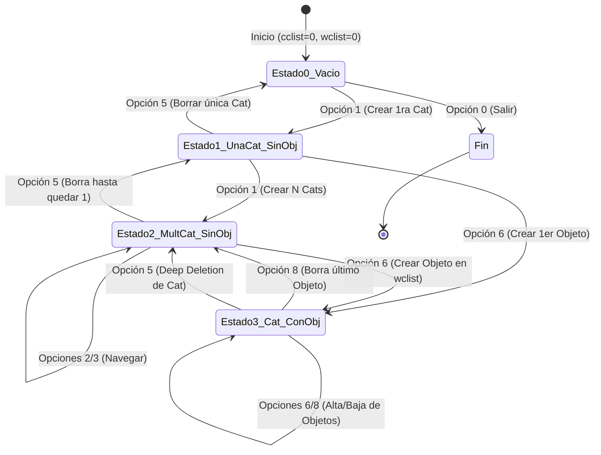
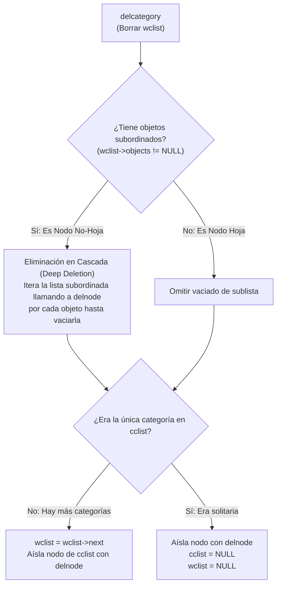

# Flujo Operativo, Ciclo de Vida y Máquina de Estados

> **Materia:** Arquitectura de Computadoras I  
> **Tema:** Flujo Natural de Control, Casos Límite, Máquina de Estados y Matriz de Transiciones  
> **Documento Complementario:** Guía de uso y análisis operacional de [`programaFinal.asm`](../programaFinal.asm)

---

## 📋 Índice Temático
1. [Objetivo Operativo del Sistema](#1-objetivo-operativo-del-sistema)
2. [El Estado en Frío (Cold Start)](#2-el-estado-en-frío-cold-start)
3. [Máquina de Estados de la Aplicación](#3-máquina-de-estados-de-la-aplicación)
4. [Ciclo de Navegación y Foco de Trabajo (`wclist`)](#4-ciclo-de-navegación-y-foco-de-trabajo-wclist)
5. [Gestión de Categorías: Nodos Hoja vs. Nodos No-Hoja](#5-gestión-de-categorías-nodos-hoja-vs-nodos-no-hoja)
6. [Matriz Exhaustiva de Estados y Comportamientos](#6-matriz-exhaustiva-de-estados-y-comportamientos)
7. [Guía de Prueba y "Camino Feliz" (Happy Path)](#7-guía-de-prueba-y-camino-feliz-happy-path)

---

## 1. Objetivo Operativo del Sistema

El programa está diseñado para operar como un **gestor de base de datos jerárquica en memoria RAM**. Permite organizar colecciones anidadas de elementos bajo dos niveles de jerarquía:
- **Nivel Maestro (Categorías):** Organizadas en un anillo circular doblemente enlazado.
- **Nivel Esclavo (Objetos subordinados):** Cada categoría aloja internamente su propio anillo circular cerrado de objetos identificados numéricamente.

La circularidad de las estructuras persigue dos objetivos fundamentales de ingeniería de software a bajo nivel:
1. **Navegación continua $\mathcal{O}(1)$:** El usuario puede recorrer las entidades de forma infinita hacia adelante o hacia atrás sin toparse con finales abruptos de lista ni requerir rebobinados costosos.
2. **Acceso instantáneo al extremo opuesto:** El último elemento de cualquier colección siempre se encuentra a un único paso de puntero desde la cabeza (`head->prev`), permitiendo inserciones al final en tiempo constante sin recorrer la lista.

---

## 2. El Estado en Frío (Cold Start)

Cuando el programa se inicia en el simulador MARS:
- `cclist = 0` (`NULL`)
- `wclist = 0` (`NULL`)
- `slist = 0` (`NULL`)

En este estado inicial, **las únicas dos acciones que NO desembocan en error son:**
1. **Opción 1: Crear una Nueva Categoría.** Inicializa el anillo maestro y activa el cursor `wclist`.
2. **Opción 0: Salir del Programa.** Finaliza la ejecución limpiamente mediante `syscall 10`.

Cualquier otra opción elegida por el usuario (opciones 2 a 8) representa una operación semánticamente inválida y es interceptada de forma defensiva por el sistema:
- Opciones 2 y 3 (Navegación): Informan **Error 201** (No hay categorías para navegar).
- Opción 4 (Listar categorías): Informa **Error 301** (Lista vacía).
- Opción 5 (Borrar categoría): Informa **Error 401** (No hay categorías para eliminar).
- Opción 6 (Crear objeto): Informa **Error 501** (No se pueden crear objetos sin una categoría contenedora).
- Opción 7 (Listar objetos): Informa **Error 601** (No existen categorías).
- Opción 8 (Borrar objeto): Informa **Error 701** (No existen categorías).

El programa nunca se interrumpe ni sufre fallas de segmentación por solicitudes indebidas: el subsistema de despacho captura el error, emite el código respectivo y retorna de inmediato al menú interactivo.

---

## 3. Máquina de Estados de la Aplicación

El comportamiento del software responde a una **Máquina de Estados Finitos (FSM)**:



### Definición de Estados:
- **Estado 0 (Vacío Absoluto):** No hay nodos en el sistema.
- **Estado 1 (Categoría Solitaria Hoja):** Hay una única categoría sin objetos. La navegación emite error 202 porque `next` y `prev` apuntan a sí mismo.
- **Estado 2 (Múltiples Categorías Hojas):** Navegación fluida $\mathcal{O}(1)$. `wclist` se desplaza libremente.
- **Estado 3 (Categoría No-Hoja Activa):** La categoría seleccionada contiene objetos subordinados. Se habilitan operaciones de listado y eliminación selectiva por ID.

---

## 4. Ciclo de Navegación y Foco de Trabajo (`wclist`)

El puntero cursor `wclist` es el **pilar operativo del programa**:
- Todas las operaciones que manipulan objetos (`newobject`, `listobjects`, `delobject`) recaen **estrictamente sobre la categoría apuntada por `wclist`**.
- La circularidad del anillo garantiza que:
  - Avanzar desde la última categoría (`nextcategory`) conduce inmediatamente a la primera.
  - Retroceder desde la primera categoría (`prevcategory`) conduce inmediatamente a la última.

```
┌─────────────────────────────────────────────────────────────┐
│                      ANILLO CIRCULAR                        │
│                                                             │
│   ┌──────────────┐     next     ┌──────────────┐            │
│   │ Categoría A  │ ───────────> │ Categoría B  │            │
│   │   (cclist)   │ <─────────── │   (wclist)   │ ◄── FOCO   │
│   └──────────────┘     prev     └──────────────┘            │
│          ▲                             │                    │
│          │                             │ next               │
│     prev │                             ▼                    │
│   ┌──────────────┐              ┌──────────────┐            │
│   │ Categoría D  │ <─────────── │ Categoría C  │            │
│   └──────────────┘     prev     └──────────────┘            │
│                                                             │
└─────────────────────────────────────────────────────────────┘
```

Si el usuario ejecuta la Opción 6 (Insertar objeto), el nuevo nodo se acopla exclusivamente dentro del anillo subordinado de **Categoría B**. Las categorías A, C y D permanecen inalteradas.

---

## 5. Gestión de Categorías: Nodos Hoja vs. Nodos No-Hoja

Al ejecutar la Opción 5 (**Borrar categoría actual**), el sistema debe actuar con rigor defensivo sobre el Heap para evitar **punteros colgantes (*dangling pointers*)** o **fugas de memoria (*memory leaks*)**:



1. **Categoría Hoja (*Leaf*):** Su campo `objects` es `NULL`. Se desenlaza directamente del anillo maestro con `delnode` y se envía a la free-list `slist`.
2. **Categoría No-Hoja (*Non-Leaf*):** Posee uno o más objetos en su sublista. El sistema entra en un bucle iterativo que desenlaza cada nodo objeto uno por uno y los devuelve a `slist`. Solo cuando la sublista queda en cero, procede a desenlazar la categoría propiamente dicha.

---

## 6. Matriz Exhaustiva de Estados y Comportamientos

La siguiente matriz detalla el resultado exacto de invocar cada opción del menú según el estado de la memoria:

| Opción de Menú | Estado 0: Sistema Vacío | Estado 1: Una Sola Cat (Hoja) | Estado 2: N Cats (Hojas) | Estado 3: Cat Activa con Objetos |
| :--- | :--- | :--- | :--- | :--- |
| **`1` Nueva Categoría** | Crea nodo, `cclist = node`, `wclist = node`. Retorna `0`. | Inserta al final del anillo. Retorna `0`. | Inserta al final del anillo en $\mathcal{O}(1)$. Retorna `0`. | Inserta al final del anillo maestro. Retorna `0`. |
| **`2` Siguiente Cat** | **Error `201`** | **Error `202`** (No hay desplazamiento). | Avanza `wclist = wclist->next`. Retorna `0`. | Avanza `wclist = wclist->next`. Retorna `0`. |
| **`3` Cat Anterior** | **Error `201`** | **Error `202`** (No hay desplazamiento). | Retrocede `wclist = wclist->prev`. Retorna `0`. | Retrocede `wclist = wclist->prev`. Retorna `0`. |
| **`4` Listar Cats** | **Error `301`** | Imprime `> Cat1`. Retorna `-1`. | Imprime todas; marca con `> ` la activa. Retorna `-1`. | Imprime todas; marca con `> ` la activa. Retorna `-1`. |
| **`5` Borrar Cat** | **Error `401`** | Libera nodo. Pone `cclist=0, wclist=0`. Retorna `0`. | Avanza `wclist` al siguiente; libera nodo actual. Retorna `0`. | Vía *deep deletion* libera todos los objetos y luego la categoría. Retorna `0`. |
| **`6` Insertar Objeto**| **Error `501`** | Agrega objeto con ID $= 1$. Pasa a Estado 3. Retorna `0`. | Agrega objeto con ID $= 1$ en `wclist`. Pasa a Estado 3. | Agrega objeto con ID autoincremental ($ID_{last}+1$). Retorna `0`. |
| **`7` Listar Objetos** | **Error `601`** | **Error `602`** (No hay objetos en esta cat). | **Error `602`** (No hay objetos en esta cat). | Recorre e imprime Nombre e ID de cada objeto. Retorna `-1`. |
| **`8` Borrar Objeto** | **Error `701`** | Imprime `notFound`. Retorna `-1`. | Imprime `notFound`. Retorna `-1`. | Solicita ID; si coincide lo libera vía `delnode`. Si no, imprime `notFound`. |
| **`0` Salir** | Termina proceso (`syscall 10`). | Termina proceso (`syscall 10`). | Termina proceso (`syscall 10`). | Termina proceso (`syscall 10`). |
| **Cualquier otro** | **Error `101`** (Validación de rango). | **Error `101`**. | **Error `101`**. | **Error `101`**. |

---

## 7. Guía de Prueba y "Camino Feliz" (Happy Path)

Para verificar en el simulador MARS la robustez del programa y la ausencia de anomalías de memoria:

1. **Creación del Primer Grupo de Categorías:**
   - Seleccionar `1` $\to$ Ingresar `"Hardware"`.
   - Seleccionar `1` $\to$ Ingresar `"Software"`.
   - Seleccionar `1` $\to$ Ingresar `"Redes"`.
2. **Comprobación de Circularidad y Listado:**
   - Seleccionar `4` (Listar): Deberá listar las 3 categorías con `> Hardware` como activa.
   - Seleccionar `2` (Siguiente): Informa selección de `"Software"`.
   - Seleccionar `2` (Siguiente): Informa selección de `"Redes"`.
   - Seleccionar `2` (Siguiente): Cierra el círculo e informa `"Hardware"`.
   - Seleccionar `3` (Anterior): Retrocede inmediatamente a `"Redes"`.
3. **Poblado de Objetos en Categoría Activa:**
   - Estando en `"Redes"`, seleccionar `6` $\to$ Nombre: `"Router"`. (Asigna ID: 1).
   - Seleccionar `6` $\to$ Nombre: `"Switch"`. (Asigna ID: 2).
   - Seleccionar `6` $\to$ Nombre: `"AccessPoint"`. (Asigna ID: 3).
   - Seleccionar `7` (Listar objetos): Comprobar que imprime los 3 objetos con sus IDs correspondientes.
4. **Prueba de Aislamiento Jerárquico:**
   - Seleccionar `2` (Siguiente categoría) para moverse a `"Hardware"`.
   - Seleccionar `7` (Listar objetos): Debe arrojar **Error 602** (lista de objetos vacía), confirmando que los objetos pertenecen exclusivamente a `"Redes"`.
5. **Borrado Selectivo y Reciclaje:**
   - Regresar a `"Redes"` con `3`.
   - Seleccionar `8` $\to$ Eliminar ID `2` (`"Switch"`). Comprobar que la operación es exitosa.
   - Seleccionar `7` (Listar objetos): Comprobar que solo quedan ID 1 (`"Router"`) e ID 3 (`"AccessPoint"`).
6. **Eliminación en Cascada (Deep Deletion):**
   - Estando en `"Redes"`, seleccionar `5` (Borrar categoría actual).
   - El sistema destruye los objetos 1 y 3 en bucle, aisla la categoría `"Redes"` y transfiere el cursor `wclist` a `"Hardware"`.
   - Seleccionar `4` (Listar categorías): Comprobar que `"Redes"` desapareció y no quedan referencias rotas.
7. **Salida Limpia:**
   - Seleccionar `0`. El programa emite `"Saliendo del programa..."` y termina limpiamente con código de salida `0`.
